<h1 align="center">🛡️ AI-Powered Cybersecurity Threat Detection System</h1>

<p align="center">
  <b>Hybrid ML intrusion detection: Random Forest for known attacks + Isolation Forest for zero-day anomalies,<br>
  with SOC-style alerts, MITRE ATT&CK mapping, incident grouping and a 24-hour attack simulation.</b>
</p>

<p align="center">
  
  
  
  
  
</p>

---

## 📌 Project Overview

Companies generate **millions of network events per day** - far more than human analysts can read.
This project builds an **AI-powered Network Intrusion Detection System (NIDS)** that:

1. **Simulates** a full day of corporate network traffic with 5 real-world attack types (DoS, port scan, brute force, data exfiltration and an *unseen zero-day*).
2. **Learns** normal vs. malicious behaviour with machine learning.
3. **Detects** threats in new "live" traffic at **~20,000 connections/second** on a laptop.
4. **Generates SOC alerts** with severity, MITRE ATT&CK technique, reason and recommended action.
5. **Groups alerts into incidents** (alert-fatigue reduction) and produces a **self-contained HTML SOC report**.

> Works fully offline using a built-in attack simulator, **and** supports the real public **NSL-KDD** benchmark dataset (`--dataset nsl-kdd`).

## ❓ Problem Statement

Rule-based security tools (firewall rules, signatures) only catch attacks someone has **already seen and written a rule for**. Attackers change tactics constantly, and SOC teams drown in false alarms.

**Goal:** build a system that (a) accurately classifies *known* attack types, (b) flags *never-seen-before* behaviour, and (c) presents results the way a real Security Operations Center consumes them - prioritised alerts, not raw predictions.

## 🏢 Industry Relevance

| Industry use case | How this project maps to it |
|---|---|
| **Intrusion detection (IDS/NDR)** - Darktrace, Vectra, Cisco Secure Network Analytics | Flow-level ML classification of network connections |
| **Anomaly detection / UEBA** - Splunk UBA, Microsoft Sentinel | Isolation Forest baseline of "normal" catches unknown threats |
| **SOC alert triage** - SIEM / SOAR platforms | Severity, MITRE ATT&CK mapping, incident grouping, recommended actions |
| **Data-loss prevention** - banks, IT services | Exfiltration detection from upload volume & duration |
| **Fraud detection** - banks / fintech | Same pattern: supervised model for known fraud + anomaly model for new fraud |

## 🧰 Tech Stack

| Layer | Tools |
|---|---|
| Language | Python 3.10+ |
| Data | pandas, NumPy |
| Machine learning | scikit-learn (RandomForestClassifier, LogisticRegression, IsolationForest, Pipeline, ColumnTransformer) |
| Visualisation | Matplotlib, Seaborn, PCA |
| Persistence | joblib |
| Testing | pytest |
| Exploration | Jupyter Notebook |

No GPU needed - full pipeline runs in **under 1 minute** on a normal laptop.

## 🏗️ Architecture

```
 ┌──────────────────────┐     ┌──────────────────┐     ┌────────────────────────┐
 │  DATA SOURCES         │     │  PREPROCESSING   │     │  FEATURE ENGINEERING   │
 │  • Attack simulator   │───▶│  • dedupe        │───▶│  • bytes_ratio, log    │
 │  • NSL-KDD dataset    │     │  • fix types     │     │  • error rates         │
 │  (network flow logs)  │     │  • fill missing  │     │  • zero_payload, etc.  │
 └──────────────────────┘     │  • clip invalid  │     │  • one-hot + scaling   │
                               └──────────────────┘     └───────────┬────────────┘
                                                                     │
                     ┌───────────────────────────────────────────────┤
                     ▼                                               ▼
        ┌──────────────────────────┐                 ┌──────────────────────────────┐
        │ SUPERVISED CLASSIFIER     │                 │ UNSUPERVISED ANOMALY DETECTOR │
        │ Random Forest             │                 │ Isolation Forest              │
        │ → attack type + confidence│                 │ (trained on NORMAL only)      │
        └────────────┬─────────────┘                 │ → anomaly score vs threshold  │
                     │                               └───────────────┬──────────────┘
                     └──────────────┬────────────────────────────────┘
                                    ▼
                   ┌─────────────────────────────────┐
                   │ DECISION ENGINE                  │
                   │ KNOWN_ATTACK / ANOMALY / BENIGN  │
                   │ + severity (LOW → CRITICAL)      │
                   └────────────────┬────────────────┘
                                    ▼
      ┌────────────────────┐   ┌─────────────────────┐   ┌──────────────────────────┐
      │ ALERTS              │──▶│ INCIDENTS            │──▶│ DASHBOARD & REPORTING    │
      │ MITRE ATT&CK, reason│   │ grouped by attacker  │   │ 12 charts + HTML report  │
      │ recommended action  │   │ first/last seen      │   │ alerts.json, metrics.json│
      └────────────────────┘   └─────────────────────┘   └──────────────────────────┘
```

Full design notes: [`docs/PROJECT_GUIDE.md`](docs/PROJECT_GUIDE.md)

## 📊 Dataset Details

**1. Built-in attack simulator (default)** - `src/simulator.py` produces connection records with the same 20 core features as KDD/NSL-KDD plus `timestamp`, `src_ip`, `dst_ip`.

| Traffic type | What it simulates | Fingerprint | Train rows | Live rows |
|---|---|---|---|---|
| `normal` | Web, mail, DNS, FTP, SSH, pings, backups | business-hours pattern | 20,000 | 10,000 |
| `dos` | SYN flood from a 25-IP botnet | S0 flags, huge `count`, `serror_rate`≈1 | 4,000 | 2,000 |
| `probe` | Port scan (+20% stealth scans) | many services, `rerror_rate` high | 1,600 | 800 |
| `brute_force` | SSH/FTP password guessing (+20% low-and-slow) | `num_failed_logins` > 0 | 1,200 | 600 |
| `exfiltration` | Insider uploading data at night | huge `src_bytes`, long `duration` | 300 | 150 |
| `anomaly` | **Zero-day**: malformed fragmented ICMP | *never in training data* | 0 | 100 |

Realism built in: class imbalance, "grey" benign traffic (backups, busy servers, password typos), stealthy attack variants and ~2% label noise (as in CICIDS2017's IP+time-window labelling).

**2. NSL-KDD (optional)** - 125,973 training / 22,544 test records, 41 features. Auto-downloaded on first use. Its test set contains attack types absent from training - a real zero-day test.

## ⚙️ Installation

```bash
git clone https://github.com/SNischayPrasad/AI-Cybersecurity-Threat-Detection.git
cd AI-Cybersecurity-Threat-Detection
python -m venv venv
venv\Scripts\activate          # Windows
# source venv/bin/activate     # macOS / Linux
pip install -r requirements.txt
```

## ▶️ How to Run

```bash
python main.py all              # simulate -> train -> detect -> report (≈1 min)
```

| Command | What it does |
|---|---|
| `python main.py generate` | Simulate the training day and the live day of traffic |
| `python main.py train` | Clean data, engineer features, train 3 models, evaluate, save charts + model |
| `python main.py detect` | Scan live traffic, raise alerts, build incidents + `outputs/soc_report.html` |
| `python main.py simulate` | Replay the live day hour by hour like a real-time SIEM feed |
| `python main.py all --dataset nsl-kdd` | Run everything on the real NSL-KDD benchmark |
| `python -m pytest -q` | Run the 7 automated tests |

## 📈 Results

**Held-out test set (6,775 connections, 25% stratified split)**

| Model | Accuracy | Precision | Recall (attack detection) | F1 | False-positive rate |
|---|---|---|---|---|---|
| Logistic Regression (baseline) | 0.985 | 0.96 | 0.980 | 0.97 | 1.28% |
| **Random Forest** (selected) | **0.995** | **1.00** | **0.979** | **0.99** | **0.00%** |
| Isolation Forest (no labels!) | 0.95 | 0.96 | 0.851 | 0.90 | 1.10% |

*Precision/recall/F1 above are attack-vs-normal. Random Forest macro-F1 across all 5 classes = 0.993.*

**Live 24-hour simulation (13,650 unseen connections, includes zero-day)**

| True traffic | Alert rate | Caught by |
|---|---|---|
| DoS | 98.4% | Random Forest |
| Probe | 98.3% | Random Forest |
| Brute force | 98.5% | Random Forest |
| Exfiltration | 99.3% | Random Forest |
| **Zero-day (never trained on)** | **95.0%** | **Isolation Forest** |
| Normal (false alarms) | 1.1% | - |

Key insight: the supervised model alone would miss the zero-day completely (it labels it "normal"). The **hybrid design** is what catches it.

**Sample alert output**
```
2026-01-16 02:00:00 [HIGH    ] ALERT-000003 DOS           213.129.211.194 -> 10.0.0.10       http      | Classifier matched 'dos' pattern (100% confidence)
2026-01-16 06:00:04 [MEDIUM  ] ALERT-001975 PROBE           136.29.188.78 -> 10.0.0.25       ldap      | Classifier matched 'probe' pattern (100% confidence)
2026-01-16 14:00:39 [MEDIUM  ] ALERT-002818 ANOMALY         78.213.82.191 -> 10.0.0.25       ecr_i     | Behaviour deviates from normal baseline (anomaly score 0.606)
2026-01-16 19:00:03 [HIGH    ] ALERT-002950 BRUTE_FORCE     174.110.240.1 -> 10.0.0.25       ssh       | Classifier matched 'brute_force' pattern (98% confidence)
2026-01-16 22:00:11 [CRITICAL] ALERT-003550 EXFILTRATION        10.0.1.64 -> 164.85.28.217   ftp_data  | Classifier matched 'exfiltration' pattern (100% confidence)
```

## 🖼️ Screenshots

| | |
|---|---|
| **24-hour attack timeline** 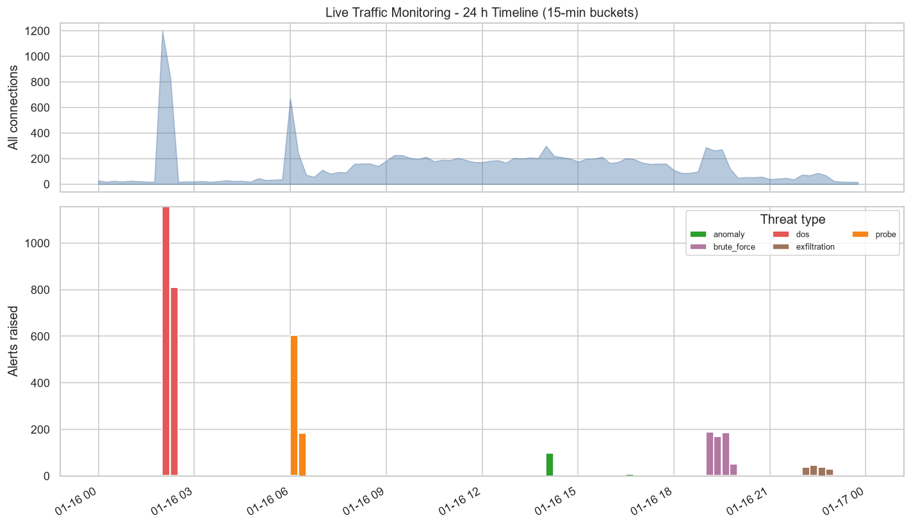 | **Confusion matrix** 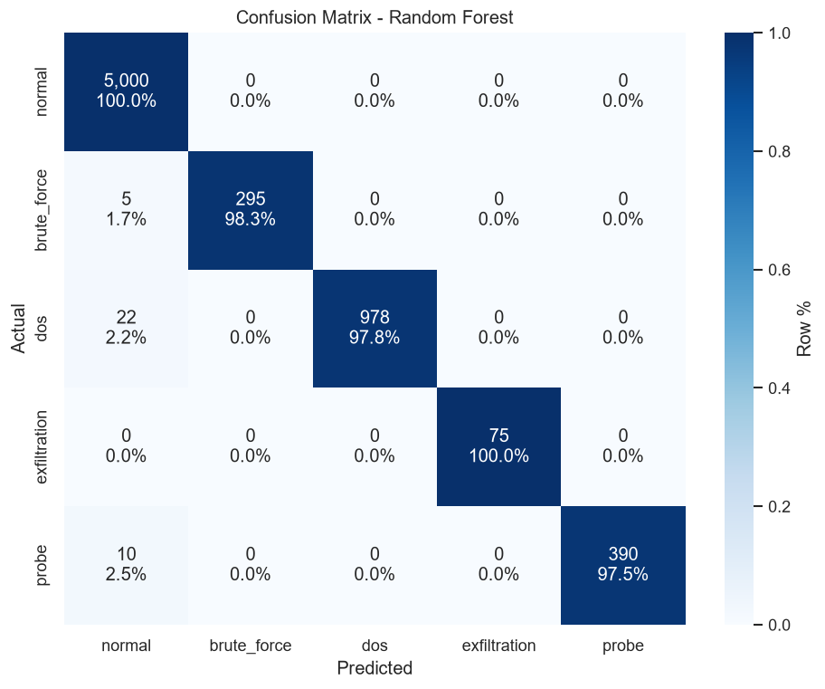 |
| **Model comparison** 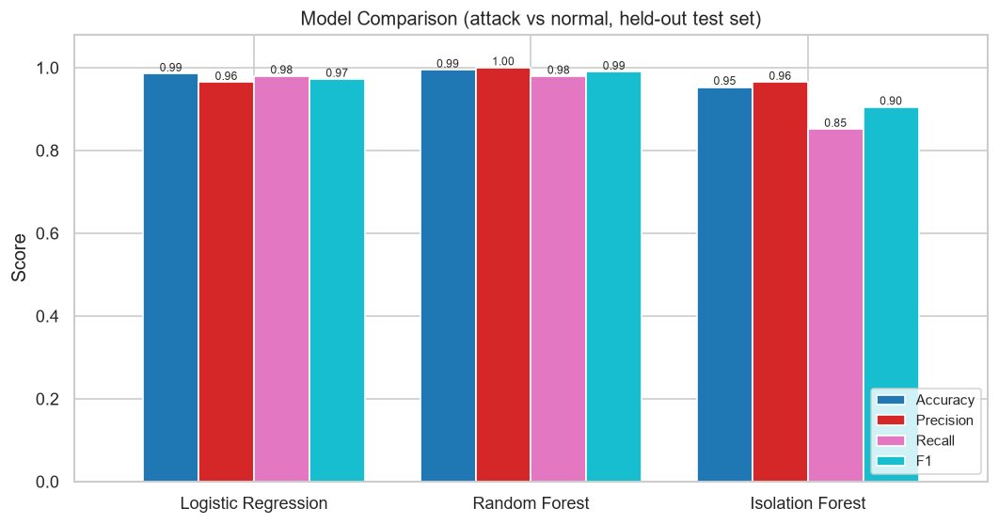 | **Zero-day vs normal anomaly scores** 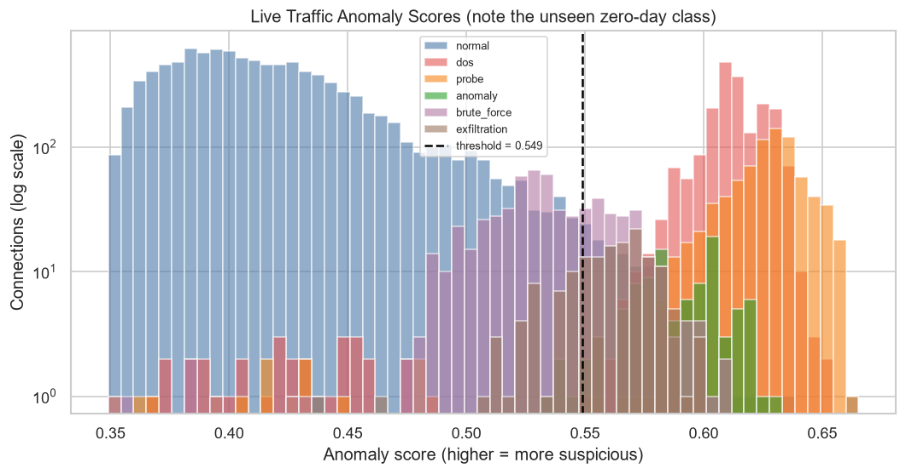 |
| **Connections in 2-D (PCA)** 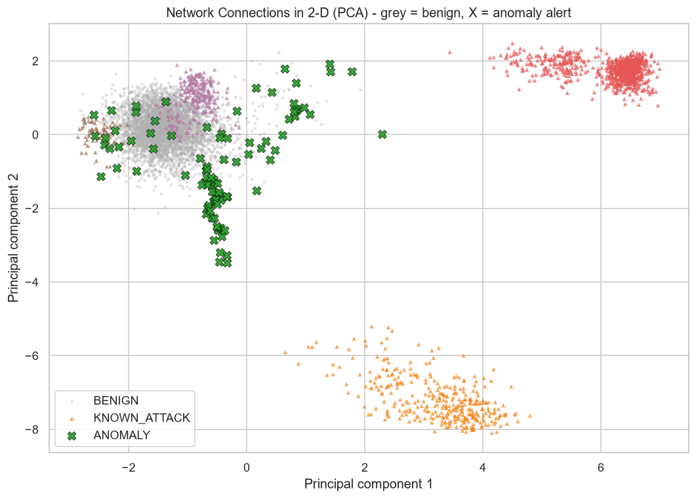 | **Detection scorecard** 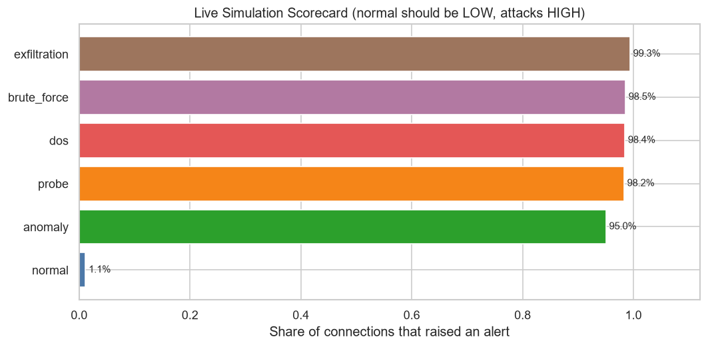 |
| **Top features** 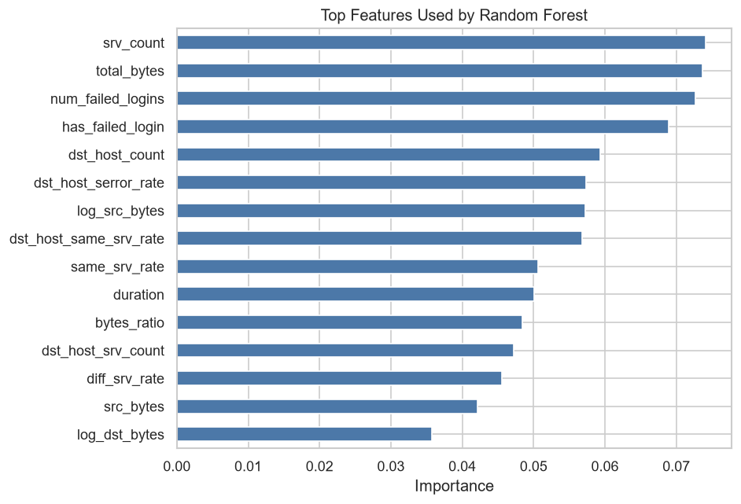 | **Alerts by severity** 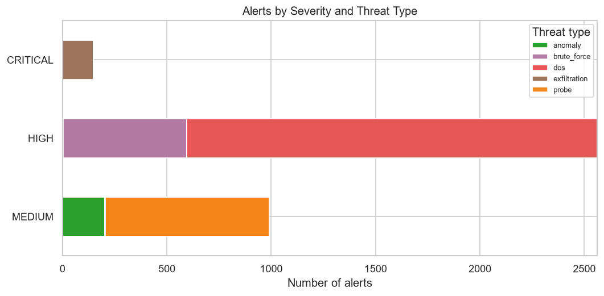 |

Full interactive report: open [`outputs/soc_report.html`](outputs/soc_report.html) in a browser after running.

### Pipeline in action

**1. Simulating traffic** - `python main.py generate`
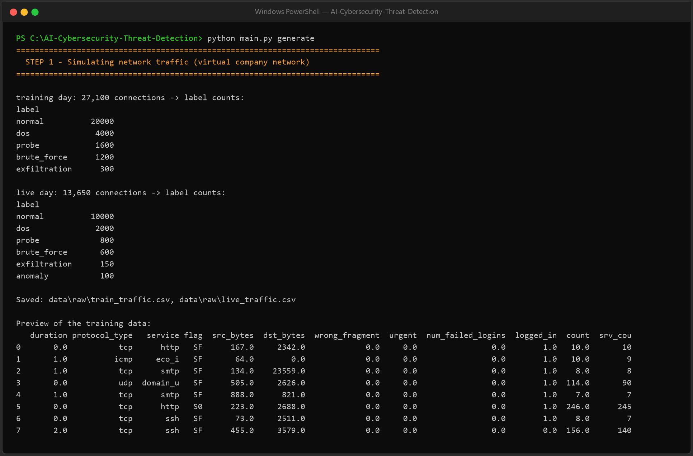

**2. Cleaning & feature engineering** - `python scripts/preprocess_demo.py`
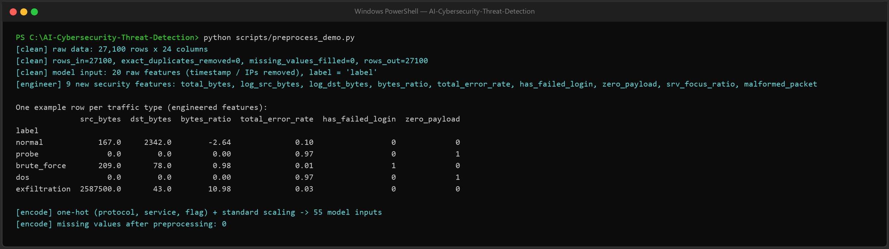

**3. Training & evaluation** - `python main.py train`
| Training logs | Evaluation metrics |
|---|---|
| 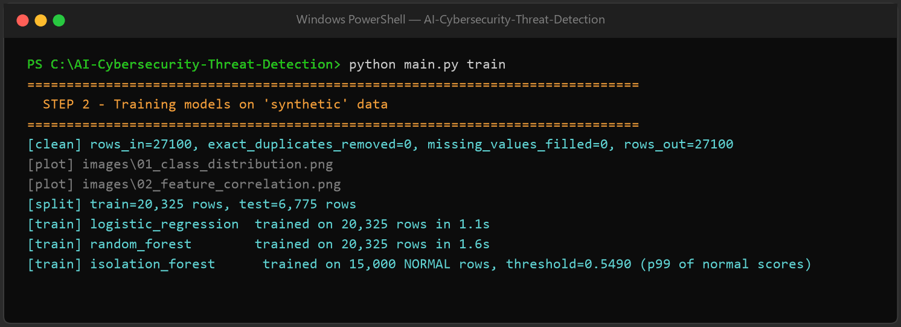 | 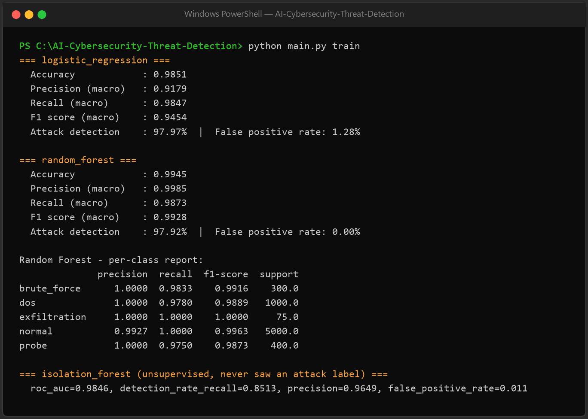 |

**4. Threat detection, alerts & incidents** - `python main.py detect`
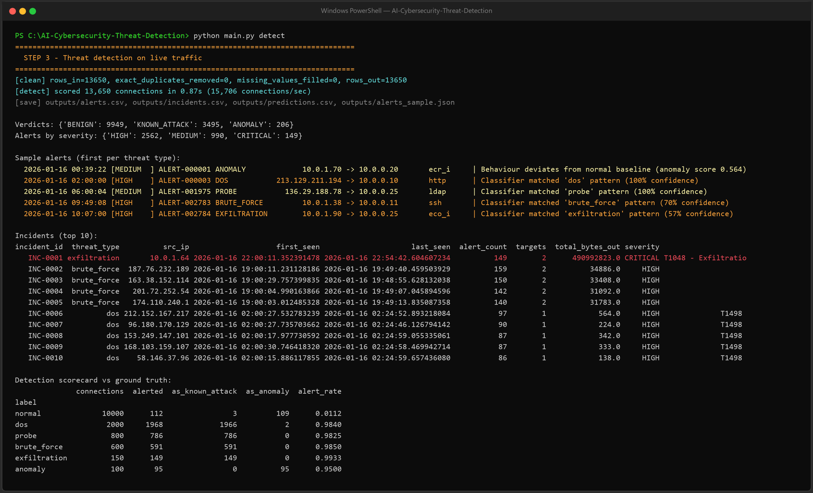

**5. Real-time simulation** - `python main.py simulate`
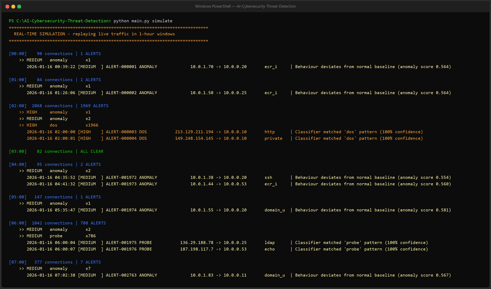

**6. SOC report** (`outputs/soc_report.html`) and **automated tests** (`python -m pytest -v`)
| SOC report | Tests |
|---|---|
| 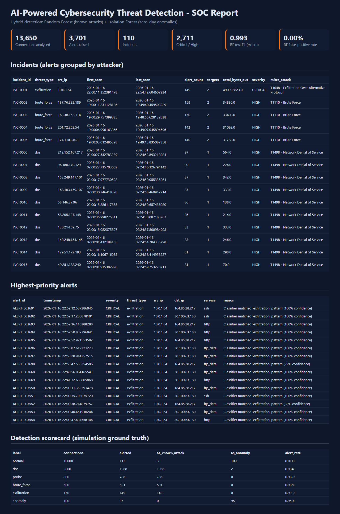 | 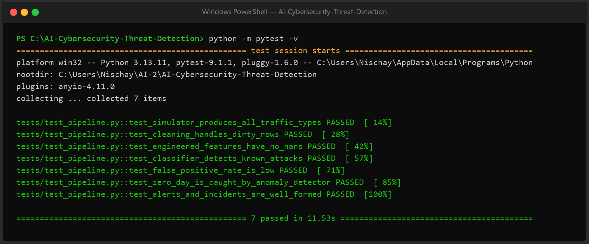 |

## 📁 Project Structure

```
AI-Cybersecurity-Threat-Detection/
├── main.py                  # CLI: generate | train | detect | simulate | all
├── src/
│   ├── config.py            # paths, thresholds, severity & MITRE mappings
│   ├── simulator.py         # virtual attack simulator (6 traffic types)
│   ├── data_loader.py       # synthetic + NSL-KDD loaders
│   ├── preprocessing.py     # cleaning, feature/label split
│   ├── feature_engineering.py # security features + encoding/scaling
│   ├── models.py            # Random Forest, Logistic Regression, Isolation Forest
│   ├── evaluate.py          # accuracy, precision, recall, F1, FPR, ROC-AUC
│   ├── detector.py          # hybrid detection, alerts, incidents
│   ├── visualize.py         # 12 charts
│   └── report.py            # HTML SOC report
├── notebooks/01_exploratory_data_analysis.ipynb
├── scripts/preprocess_demo.py # shows the cleaning + feature-engineering stage
├── tests/test_pipeline.py   # 7 pytest tests
├── data/  models/  outputs/  images/  docs/
├── requirements.txt  .gitignore  LICENSE  README.md
```

## 🎓 Learning Outcomes

- End-to-end ML pipeline design: ingestion → cleaning → feature engineering → training → evaluation → deployment-style inference.
- Why **precision, recall and false-positive rate** matter more than accuracy in security (class imbalance, alert fatigue).
- **Supervised vs unsupervised** detection and why real products combine them.
- Domain knowledge: how DoS, port scans, brute force and exfiltration appear in network flow data; MITRE ATT&CK.
- Avoiding **training/serving skew** with scikit-learn Pipelines; reproducibility with fixed seeds.
- Software engineering: modular code, CLI, automated tests, documentation.

## 🚀 Future Improvements

- Train on CICIDS2017 / UNSW-NB15 and compare across datasets
- XGBoost / LightGBM and SHAP explanations per alert
- Streamlit live dashboard; Kafka stream ingestion
- Docker image + REST API (FastAPI) for real-time scoring

## ⚠️ Disclaimer

Educational project. Results on simulated data are optimistic compared with production networks; the NSL-KDD option provides a harder, research-grade benchmark.

## 👤 Author

**Sadhanala Nischay Prasad** · [GitHub](https://github.com/SNischayPrasad)

⭐ If you found this useful, consider starring the repo!
